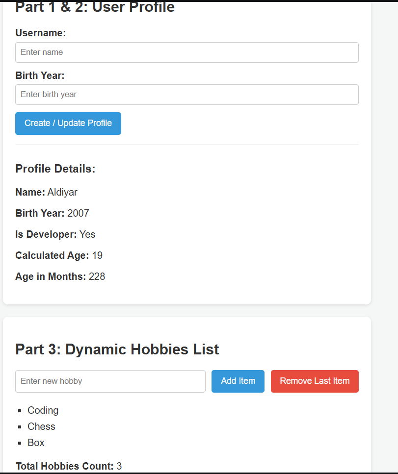

# Assignment 5 JavaScript Basics
*Student Name:* Zhurek Aldiyar
*Group:* SE-2540

---

# Project Overview

This project is a dynamic web application built for *Assignment 5* to demonstrate essential JavaScript concepts, including data types, DOM selection and manipulation, event listeners, and dynamic list management.

---

# Features and Assignment Parts

# Part 1: Profile Object, Data Types and Arithmetic
* Created a JS "userProfile" object containing primitive and reference data types ("string", "number", "boolean", "arra").
* Performed dynamic arithmetic calculations to display the calculated age and total months old based on the current year.

# Part 2: Form Input and Event Responses
* Built an HTML form with input fields for *Username* and *Birth Year*.
* Attached a "submit" event listener using "addEventListener" to capture user input, perform explicit type conversion ("Number"), and dynamically update the "userProfile" object and DOM display without page reloads ("event.preventDefault()").

# Part 3: DOM List Manipulation
* Created an interactive hobbies list using an unordered list ("ul").
* Implemented an *Add Item* button to dynamically create ("document.createElement") and append ("appendChild") new "li" elements.
* Implemented a *Remove Item* button to delete the last element ("removeChild") from both the DOM and the array.

---

# Application Interface and Functionality Demonstration

---

# Work Process Summary

1. *HTML Structure:* Created a semantic and accessible markup containing card sections for profile details and the dynamic list.
2. *CSS Styling:* Applied modern layout styles using Flexbox, clean typography, and responsive controls for a clean UI.
3. *JavaScript Logic:* Separated behavior into "script.js" to ensure clean architecture. Used standard DOM selection methods ("getElementById"), event handlers ("submit", "click"), and dynamic manipulation methods ("appendChild", "removeChild").
4. *Deployment:* Pushed code to a public GitHub repository and deployed it via *GitHub Pages*.